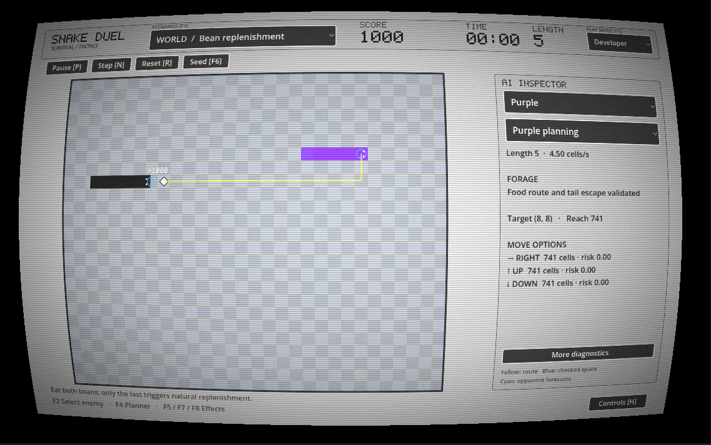
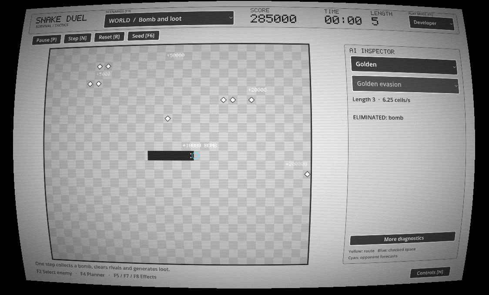
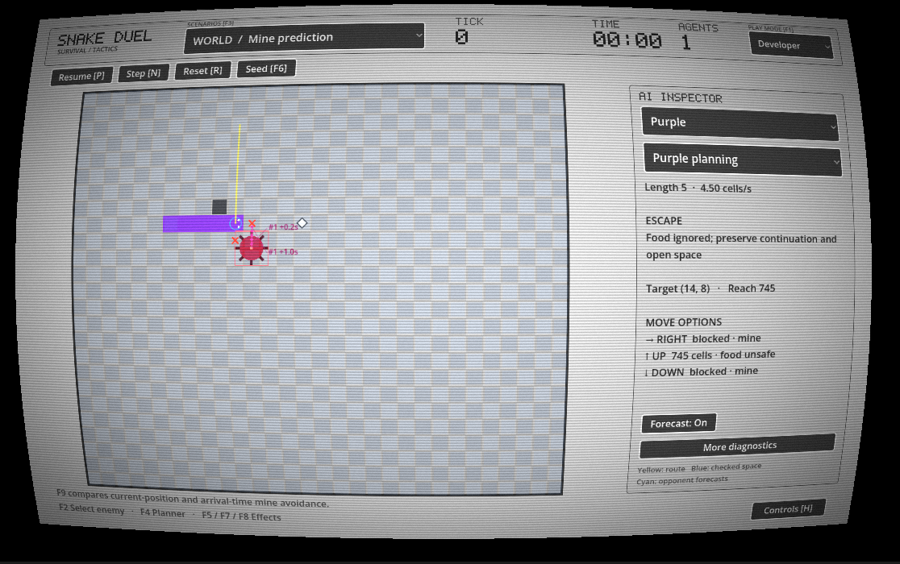
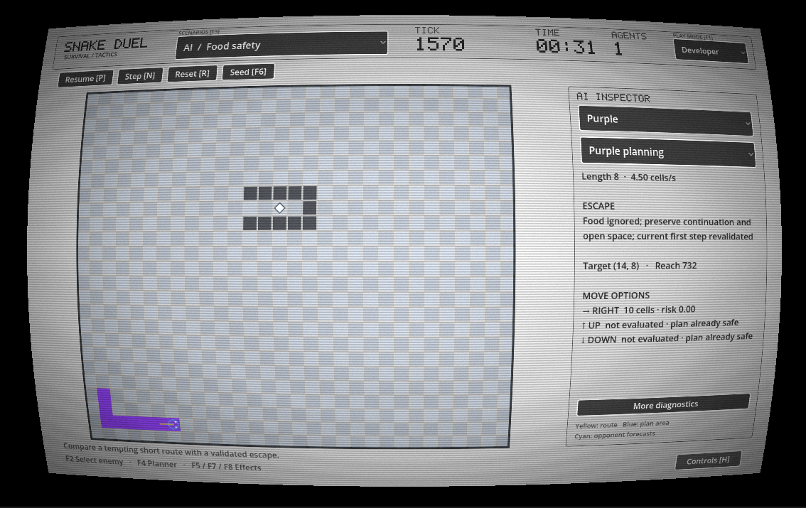
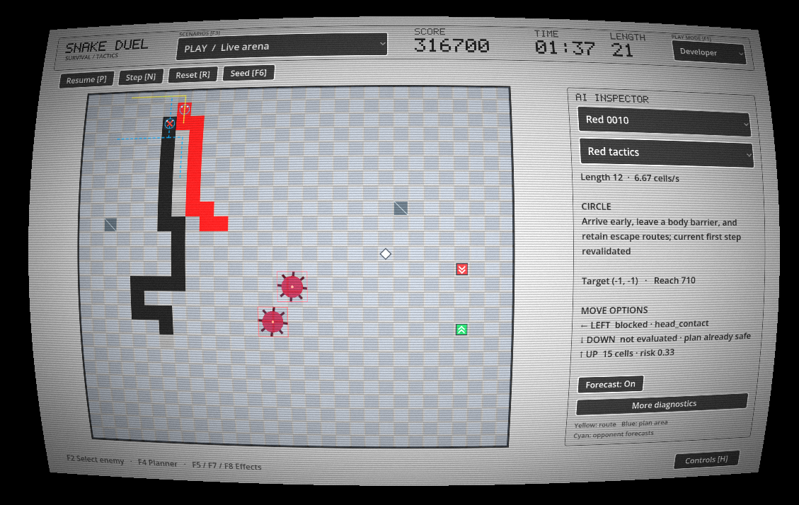

# godot-snake-duel

**Solo personal project · October–November 2026**  
**Godot 4.7.2 · GDScript · Godot shader language · Playable prototype**

Snake Duel expands classic Snake into an arena shared with four kinds of AI opponent. I developed the game as a personal portfolio project, focusing on enemy behaviour, pathfinding, decision making and the communication of those decisions to the player.

Two features define the project:

- **Visible AI reasoning.** Developer mode displays the selected enemy's target, route, explored space, possible opponent movements and reasons for rejecting a move.
- **A retro CRT presentation.** Curvature, scanlines, glow, grain and pixel lettering give the game the appearance of an old computer display, with a restrained grey arena and coloured enemies.



*The CRT display combines pixel lettering and a curved arena with inspectable AI. Here, Purple’s yellow route has passed food and tail-escape validation; the player has just earned a 1,000-point bean reward.*

## Run the game

1. Install **Godot 4.7.2**, the version used to validate this project. The standard editor is sufficient; .NET is not required.
2. Import the `project.godot` file in this folder. Allow Godot to import the resources.
3. Press **F5** in the editor, then choose a play mode and scenario from the opening menu.
4. Choose **Normal + Live arena** to play, or **Developer + Food safety** to begin inspecting the AI.

The project uses the **Compatibility** renderer. The scene, interface, procedural graphics, shader and sound generation are included; no asset download, editor plugin, external service or API key is required.

### Controls

| Input | Action |
|---|---|
| WASD / arrow keys | Steer; up to two turns can be buffered |
| Hold Space | Player-only boost |
| P / Esc | Pause or resume |
| H | Show the in-game controls |
| F12 / Alt+Enter | Toggle fullscreen |
| F1 | Switch between Normal and Developer presentation |
| F2 | Select another enemy to inspect |
| F3 | Open the scenario picker |
| N | Pause and advance one 0.02-second simulation tick |
| R | Reset the current scenario with the same seed |
| F6 | Advance the seed and reset |
| F4 | Change the selected enemy's planner for comparison |
| F5 / F7 / F8 | In Developer mode, toggle Star / Speed Up / Slow Down |
| F9 | In Developer mode, compare predictive and current-position mine avoidance |
| F10 | In Developer mode, toggle Purple's moving-diamond planning |
| F11 | Show runtime planning and simulation diagnostics |

Normal/Developer mode and the selected scenario are independent. Changing presentation does not restart the world. Manual stepping uses the complete synchronous planner; interactive play uses early strategic planning followed by a fresh safety check.

## Core gameplay

The player starts at length **5** on a **30 × 25** grid. Collect beans to grow, increase future rewards and use the body to cut off enemies. A longer body can control more space, while also making crowded routes harder to navigate. Head contacts start a duel that consumes length over time; turning away can provide an escape.

The first AI enters after **three simulation seconds**. Later arrivals depend on score, cooldowns and available enemy slots. Up to **four enemies** can be alive, including duplicates. Enemies enter head-first from distant arena boundaries, with the remaining body entering progressively and no spawn warning.

The arena begins with one bean. When the last bean is eaten, another spawns naturally. Eliminated snakes can also drop beans, with rolls based on length and archetype, a minimum drop when placement permits, and a small chance of replacement by a diamond.

### Enemies

| Enemy | Initial length | Default speed | Behaviour |
|---|---:|---:|---|
| Pink | 3 | 3.5 cells/s | A passive collector with a deliberate 0.30-second delay in observing rivals. Sudden close cutoffs can defeat it. |
| Purple | 5 | 4.5 cells/s | A cautious collector that validates food and diamond plans against growth, continuation and tail escape. |
| Red | 12 | About 6.67 cells/s | An aggressive interceptor that tries to place body barriers across predicted player routes and reduce available space. |
| Golden | 3 | 6.25 cells/s | An agile, non-aggressive bonus opponent that preserves exits and separation. It can eat beans incidentally but does not pursue them. |

These are configurable starting values. Enemy bodies can grow, so an archetype's initial length is not a permanent cap. Difficulty comes from the combination of objectives, information, body length and speed.

### Boost effects and moving objects

- **Boost:** hold Space for unlimited acceleration, with no length cost. Normal player speed is 5 cells/s; boost alone is 11.25 cells/s. Speed Up, Slow Down and boost combine additively. Even the slowed boosted player moves faster than every default enemy.
- **Star:** grants ten seconds of invulnerability. Enemy contact eliminates the enemy, and player-head contact destroys mines. Wall and self-body contacts block movement and reduce length, with a minimum living length of one. The protected player can also remove generated obstacles by entering their cells.
- **Speed Up / Slow Down:** player-only effects that change movement timing for ten simulation seconds. Recollection refreshes the effect.
- **Diamonds:** moving rewards that add growth. Purple can plan timed interceptions rather than routing to an outdated position.
- **Mines:** moving hazards at 1.25 cells/s, with equal total speed on diagonals. They bounce at boundaries and pass through ordinary bodies and obstacles. Unprotected head contact is fatal, including during Second Chance or a duel.
- **Bombs:** moving pickups that clear obstacles, mines and living AI enemies, awarding the pickup value and normal elimination bounties. Score-triggered warnings and later enemy spawning can rebuild arena pressure.
- **Obstacles:** begin appearing at 200,000 points. They constrain all AI and unprotected player movement; mines, diamonds and bombs pass through them.

### Scoring and tactical trade-offs

All rewards share a length-based formula:

```text
Base score = 100 × current player length + 500
Reward     = Base score × reward multiplier
```

| Reward | Multiplier | Points at player length 5 |
|---|---:|---:|
| Bean | ×1 | 1,000 |
| Pink elimination | ×5 | 5,000 |
| Purple elimination | ×20 | 20,000 |
| Red elimination | ×50 | 50,000 |
| Golden elimination | ×200 | 200,000 |
| Diamond, Speed Up, Bomb, Star or Slow Down | ×10 each | 10,000 each |

Actual segments count when rewards are resolved; newly queued growth affects later rewards. Bounties use the player's length, and enemy deaths must be attributed to a living player to earn points. Previously earned points remain unchanged when the player shrinks.

This gives growth a continuing value. It also makes deliberate shortening during Star a trade-off: manoeuvrability improves while subsequent rewards fall. Slow Down still gives positive points, so collecting it can be tempting in an unsafe position. Golden's large bounty gives the player a reason to pursue an opponent that does not attack.

Each newly crossed 50,000-point threshold requests a mine, capped at eight including warnings and reserved spawns. A large bomb payout can therefore clear the arena and introduce new warning mines after scoring.



*Bomb and loot scenario: at player length five, the bomb pickup and one bounty from each archetype award 285,000 points. Enemy drops remain on the field after the clear.*

## Core AI design

The enemies use **custom BFS, flood fill, shared body-and-growth simulation, bounded forecasts and utility ranking**. The game does not use machine learning, minimax or MCTS.

### 1. Establish legal moves before searching

Each decision considers straight, left and right in a fixed order. The shared simulation rejects reversal, walls and occupied bodies. Own-tail entry is permitted only when the segment actually vacates without growth; other snakes' tails remain conservatively occupied.

Legal fallback moves are established before optional route search, so reaching a search limit does not erase an otherwise available escape.

### 2. Find routes and estimate space

The small grid has equal movement costs, making **breadth-first search** suitable for shortest routes and distance maps. Packed arrays store flattened cell indices, parent links and visited state. Fixed neighbour order keeps ties reproducible.

The same traversal performs **flood fill** after a simulated candidate move. The starting space requirement is:

```text
body length + pending growth + max(2, ceil(body length × 0.25))
```

Accessible area is a heuristic. A large region may still become unsafe, and a moving-tail loop can remain survivable in a small static region. The planner can validate a route toward its vacating tail as additional escape evidence.

### 3. Consider growth and arrival time

Purple simulates a proposed reward route through the game's movement and growth functions. It requires collection, a legal continuation and a validated tail route after eating. An incomplete validation rejects the reward plan.

Mine forecasts include activation, bouncing and movement through the interval until the snake can act again. Opponent-head forecasts consider visible direction, body, speed and movement phase. They do not read queued player controls or another AI's selected future action. Mines are assumed to persist until their destruction is observed.



*Timed mine prediction: projected hazard positions and rejected directions explain why Purple abandons the food route and moves toward open space.*

### 4. Rank objectives within the best safety tier

An attractive reward cannot override immediate legality or a better safety tier. Purple's initial normalized food-plan utility is:

```text
U = 3 × FoodAccess + 4 × AvailableSpace
    + 3 × EscapeOptions − 3 × ThreatExposure
```

Pink prefers the shortest acceptable bean route. Purple adds growth and escape validation. Red rewards early interception and reduction of the player's reachable space. Golden rewards exits, head clearance and lower threat, with no attack or food-pursuit term. A player with Star causes Red to abandon attacks and Golden to increase separation.

When no food plan qualifies, food rewards are ignored and the enemy prioritizes escape. These checks reduce avoidable deaths; changing opponents and finite lookahead still make survival uncertain.



*Food safety scenario: Purple remains in escape mode when the reward inside the narrow pocket does not offer an acceptable continuation.*



*Red’s tactical movement: the inspector exposes the circling objective, route, head-contact rejection and current first-step validation. Cyan lines show possible player movement.*

### 5. Make decisions inspectable

The AI inspector shows targets, behaviour, reasons, rejected directions, reachable area and work costs. Yellow lines show proposed routes, blue shading shows the associated explored area, and cyan dashed lines show possible player routes. Earlier strategic plan area is labelled separately from freshly checked space; unevaluated alternatives are not presented as rejected moves.

The 16 playable scenarios preserve focused demonstrations of food pockets, crossing routes, moving tails, Pink cutoffs, Red interception, Golden escape, duels, speed effects and moving hazards. Reset, seed selection, stepping and planner switches support repeated comparisons.

## Programming techniques and architecture

- **Separation of simulation and presentation:** `WorldSnapshot` and `SnakeState` contain game data; `SnakeSimulation` resolves rules; player, arena and UI nodes render the result. Prediction uses the same movement, growth and collision primitives as gameplay.
- **Fixed simulation with interpolated drawing:** the world advances in 0.02-second ticks. Fractional movement phases preserve different speeds and effect transitions, while interpolation keeps movement smooth between completed states.
- **Simultaneous resolution:** snakes due to move together submit intents against the same prepared state. The resolver applies those intents jointly.
- **Data-oriented graph traversal:** packed arrays, integer cell indices, reusable queues and visited-generation stamps reduce search allocation and repeated clearing.
- **Isolated worker jobs:** `WorkerThreadPool` jobs own snapshots, profiles and mutable search data. They do not access scene nodes, input or rendering.
- **Configurable resources:** exported enemy and drop resources expose speed, length, cooldowns, scores, limits and safety parameters in the Godot Inspector.
- **Procedural presentation:** the arena, snakes and pixel lettering are drawn in code. Short sound effects use generated audio samples, and the CRT appearance comes from a canvas shader.

### Source structure

```text
SnakeDuel_GitHub/
├── project.godot
├── README.md
├── THIRD_PARTY_NOTICES.md
├── icon.svg
├── screenshots/             # Gameplay and AI images used by this README
├── scenes/
│   └── main.tscn
├── resources/
│   ├── enemy_spawning.tres
│   └── drops.tres
├── scripts/
│   ├── main.gd                 # Viewport, CRT host and fullscreen handling
│   ├── game.gd                 # Input, game flow, tick scheduling and UI
│   ├── player.gd               # Snake drawing and player turn buffering
│   ├── playground.gd           # Arena and pickup rendering
│   ├── ui_layout.gd            # Board fitting and inspector bounds
│   ├── audio_fx.gd             # Procedural sound generation
│   └── ai/
│       ├── snake_ai.gd         # Safety, reward plans and tactical ranking
│       ├── grid_search.gd      # BFS, flood fill and path reconstruction
│       ├── snake_simulation.gd # Shared movement, contact and reward rules
│       ├── world_snapshot.gd   # World state and isolated prediction copies
│       ├── enemy_profile.gd    # Archetype objectives and planning weights
│       ├── planning_ahead.gd   # Early planning and job lifecycle
│       ├── mine_forecast.gd    # Timed movement and hazard validation
│       ├── score_rules.gd      # Shared length-based scoring
│       └── ai_scenarios.gd     # Playable scenario definitions
└── shaders/
    └── crt.gdshader
```

The tree highlights the main entry points; the accompanying scripts and `.uid` files are also required project sources. For an AI code review, start with [snake_ai.gd](scripts/ai/snake_ai.gd), [grid_search.gd](scripts/ai/grid_search.gd), [snake_simulation.gd](scripts/ai/snake_simulation.gd) and [planning_ahead.gd](scripts/ai/planning_ahead.gd).

## Main engineering challenge — movement stutter

The most difficult problem was a sticky movement sensation when Purple entered the arena, even with few objects present. A steady rendering rate initially hid the problem: frames could continue near 60 FPS while completed world updates arrived unevenly.

### Cause

Purple evaluated food routes, future growth, tail escape and opponent threats. Distant food could require expensive prediction even on an empty board. AI already ran on workers, but planning began when an enemy was due to move, and the world waited for all due decisions. Interpolation reached the last available state and stopped; completed work could then produce a burst of catch-up ticks.

### Solution

I changed the prediction cost and scheduling together:

1. **Share the movement primitive.** Legal predictions with no global contact or reward interaction use an event-free shortcut. Contact-sensitive cases continue through the full resolver.
2. **Plan between moves.** Optional strategy starts before the next movement deadline, with at most one in-flight job per actor, including obsolete work.
3. **Validate the current first step.** At the deadline, current bodies, effects, threats and hazards are checked again. A missing, stale or unsafe strategy uses a fresh survival fallback.
4. **Reserve work for safety.** The default 8,192-operation allowance is divided into up to 6,144 strategic operations and 2,048 current-safety operations. Once the preferred direction reaches the highest safety tier, unnecessary alternatives can remain unevaluated.
5. **Reuse predictions within a tick.** Complete rival-head envelopes can be shared inside one immutable prepared tick, with the same logical charge per caller. Worker copies and later ticks cannot reuse that mutable cache.

This preserves the growth, escape and archetype requirements while allowing interactive movement to advance without waiting for optional strategy. Manual stepping retains the original full-planner comparisons. Earlier planning and fallback use can change live trajectories, so identical interactive outcomes are not claimed.

### Measured outcome and limits

An earlier local comparison used Godot 4.7.2, the same 1152 × 648 CRT view and scripted player, with 30 warmup frames and 600 recorded frames per condition. Heavy layouts began with eight mines and sixteen diamonds.

| Workload | Longest world-update gap before → after | Simulation ticks per real second before → after |
|---|---:|---:|
| One Purple, clear arena | 66.69 → 33.42 ms | 50.08 → 50.08 |
| Four Purples, clear arena | 100.03 → 34.99 ms | 50.08 → 50.08 |
| One Purple, heavy arena | 116.68 → 59.64 ms | 49.65 → 50.05 |
| Four Purples, heavy arena | 200.14 → 33.97 ms | 33.38 → 50.03 |

The four-Purple heavy case reduced the longest update gap by about 83% and increased simulation throughput by about 50%. That case's rendered-frame 95th percentile also increased from about 16.7 to 18.5 ms, and the single-Purple heavy case retained a roughly 60 ms worst update gap. These short workload measurements do not establish a universal frame-rate or survival improvement. Dense hazards and longer sessions remain optimization targets.

The development regression suite contains **213 tests and six scene smoke checks**, covering rules, prediction isolation, growth, effects, timing, spawning, drops and early-plan validation. That suite is maintained in the development project; this folder is the playable runtime distribution.

## Other design problems I resolved

**Useful differences between enemies.** A collector that reacted instantly to every player turn made close cutoffs ineffective. Pink now observes rival poses with a configurable delay, while terrain, self-body and mine checks stay current. Red uses interception objectives; Golden has an evasion objective and can still eat food incidentally. Shared safety supports distinct behaviours.

**A complete board inside the CRT.** The earlier viewport could clip the arena at different window sizes. I separated the fixed 1440 × 900 logical canvas from the physical window size, applied uniform aspect fitting, and reserved independent space for the inspector. The full grid remains visible when switching presentation or fullscreen mode.

**Consistent prediction across different speeds.** Boost, speed effects, moving mines and growth affect when cells become safe. Fractional phase carry, simulation-time effect expiry and shared contact calculations keep those changes consistent between gameplay and forecasts. A geometric shortest path is evaluated against its arrival time and body consequences.

## Tune and explore

Select **Main** in `scenes/main.tscn`:

- **Enemy Spawning:** edit per-type unlock score, selection weight, starting length, speed, population limits, respawn cooldown, reaction delay and planning settings.
- **Drops:** adjust per-segment bean chances, difficulty differences and diamond replacement.
- **AI Scheduling:** turn **Early Planning Enabled** off to inspect the older worker-batch scheduling policy.

The resources are saved in [enemy_spawning.tres](resources/enemy_spawning.tres) and [drops.tres](resources/drops.tres). Utility defaults live in [enemy_profile.gd](scripts/ai/enemy_profile.gd); speed composition is defined in [speed_rules.gd](scripts/ai/speed_rules.gd).

## Inspiration and references

Gameplay inspiration includes classic Snake and Snake Duel from *Zenless Zone Zero*. This is an independent implementation with its own AI policies and CRT presentation; reference screenshots and videos are not distributed with the project.

Algorithm concepts were adapted to this game's growth, multiple snakes, collision rules and work budgets:

- [Battlesnake useful algorithms](https://docs.battlesnake.com/guides/useful-algorithms) — route finding and flood-fill space checks.
- [chynl/snake graph-search implementation](https://github.com/chynl/snake/blob/main/src/agents/graph.py) — reference pattern of simulating food collection and checking tail access.
- [David Graham, An Introduction to Utility Theory](https://www.gameaipro.com/GameAIPro/GameAIPro_Chapter09_An_Introduction_to_Utility_Theory.pdf) — normalized decision factors and configurable utility ranking.

These are conceptual references, not runtime dependencies. The GDScript implementation is written for this game. Third-party icon and engine credits are recorded in [THIRD_PARTY_NOTICES.md](THIRD_PARTY_NOTICES.md).
